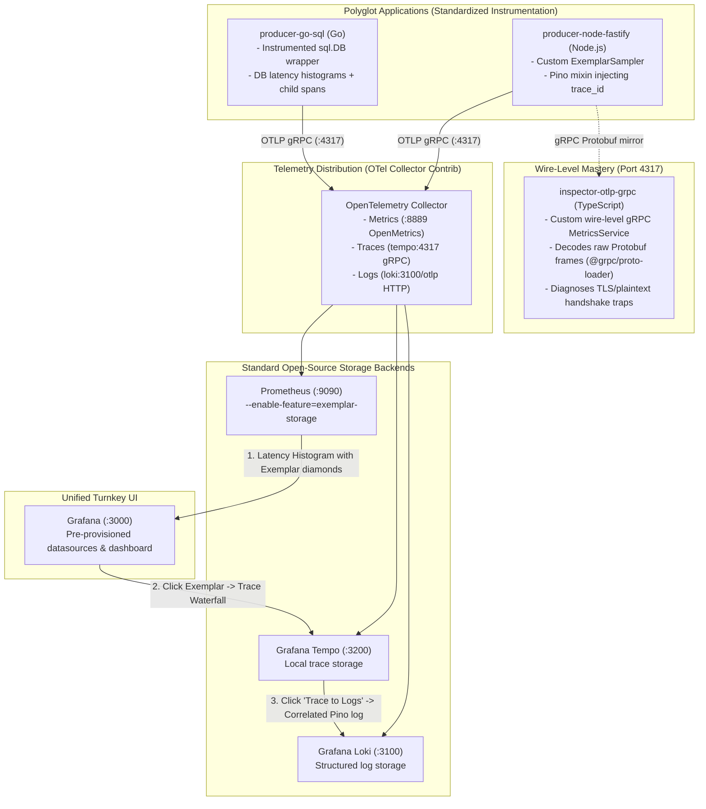

# otel-exemplars-lab - Polyglot OpenTelemetry Telemetry Distribution & Exemplars Reference Lab

[](https://github.com/betaucourt/otel-exemplars-lab/actions)
[](./LICENSE)
[](https://opentelemetry.io/)
[](https://prometheus.io/)
[](https://grafana.com/)

A reference observability laboratory and architectural Proof of Concept (PoC) demonstrating how to **distribute standardized OpenTelemetry collector endpoints, telemetry conventions, and polyglot instrumentation across projects and technologies** - achieving full **Metric -> Trace -> Log correlation** without expensive proprietary SaaS vendors like Datadog or Dynatrace.

---

## The Core Mission: Code-First Telemetry vs. Vendor Lock-In

### 1. Distributing Telemetry Across Technologies (The Shared PoC)
In distributed organizations, development teams often reinvent telemetry configurations, hardcode disparate endpoints, or struggle with inconsistent semantic conventions. `otel-exemplars-lab` demonstrates a **shared reference architecture** that standardizes:
- Centralized OpenTelemetry Collector routing for metrics, traces, and structured logs.
- Uniform endpoint distribution (`:4317` gRPC / `:4318` HTTP) across diverse languages (Node.js, Go).
- Consistent correlation rules linking HTTP requests, database queries, and structured logs.

### 2. Defeating the "p99 Mystery" with Prometheus Exemplars
When production latency spikes (p99 exceeds 2s), standard dashboards report that the system is slow, but cannot identify *which* request caused the spike. Distributed traces contain details but are unlinked from aggregate rates.

**OpenTelemetry Exemplars** bridge this gap by attaching active trace IDs (`trace_id`, `span_id`) directly to Prometheus histogram sample buckets. Clicking a latency spike on a Prometheus chart opens the exact trace and correlated structured log line in Grafana.

---

## Architecture & Turnkey Observability Stack



---

## Project Structure & Components

| Component | Technology | Role & Key Implementation Details | Documentation |
| :--- | :--- | :--- | :--- |
| **[`producer-node-fastify/`](./producer-node-fastify)** | Node.js 22, Fastify, Pino | Manual OpenTelemetry SDK bootstrap with custom `createTraceIdRatioExemplarSampler` and Pino structured log correlation. | [Component Guide](./producer-node-fastify/README.md) |
| **[`producer-go-sql/`](./producer-go-sql)** | Go 1.24, `database/sql` | Custom `InstrumentedDB` wrapper recording query latency histograms (`db_query_duration_seconds`) and database child spans. | [Component Guide](./producer-go-sql/README.md) |
| **[`inspector-otlp-grpc/`](./inspector-otlp-grpc)** | TypeScript, `@grpc/grpc-js` | Wire-level packet analyzer compiling official OTLP `.proto` files to inspect raw binary payloads, verify exemplars, and debug handshakes. | [Component Guide](./inspector-otlp-grpc/README.md) |
| **`collector/`** | OTel Collector, Prometheus, Tempo, Loki, Grafana | Production-grade configuration and pre-provisioned Grafana datasources with automatic Exemplar-to-Trace and Trace-to-Log links. | [Stack Guide](./collector/README.md) |

---

## Turnkey 1-Click Walkthrough

Start the complete stack in a single command:

```bash
# 1. Start Collector, Prometheus, Tempo, Loki, and Grafana
docker compose up -d

# 2. Verify all services are healthy
docker compose ps

# 3. Open Grafana (Pre-configured Admin, no login required)
open http://localhost:3000
```

### The 3-Step Exemplar Correlation Experience:
1. Open the pre-loaded **OpenTelemetry Exemplars & Correlated Telemetry** dashboard.
2. In the **HTTP Latency Quantiles** panel, locate a latency spike and click on the **Exemplar diamond**.
3. Grafana automatically splits the view into **Tempo** (displaying the distributed trace waterfall) and allows you to click **"Explore Logs with this TraceID"** to view the exact correlated Pino log line in **Loki**.

---

## Quality & Verification

- **CI Pipeline**: Multi-service validation on GitHub Actions (Go build & test, TypeScript build, shell check).
- **Zero Secrets**: Pure local loopback networking with zero external cloud dependencies.

---

## References & Upstream Sources

### OpenTelemetry Standards & Protocols
- **[OpenTelemetry Specification](https://opentelemetry.io/docs/specs/otel/)**: The industry standard telemetry specification defining the unified data model for Metrics, Traces, and Logs.
- **[OpenTelemetry Protocol (OTLP)](https://github.com/open-telemetry/opentelemetry-proto)**: Official Protobuf schemas including `opentelemetry.proto.collector.metrics.v1`, `trace.v1`, and `logs.v1`.
- **[OpenTelemetry Semantic Conventions](https://opentelemetry.io/docs/specs/semconv/)**: Standardized attribute taxonomies for HTTP requests (`http.method`, `http.status_code`) and relational database operations (`db.system`, `db.statement`).

### Wire-Level gRPC & Protobuf Engineering
- **[gRPC Protocol Specification](https://grpc.io/docs/what-is-grpc/core-concepts/)**: High-performance RPC framework leveraging HTTP/2 binary framing and multiplexed transport on port `4317`.
- **[`@grpc/grpc-js` & `@grpc/proto-loader`](https://github.com/grpc/grpc-node)**: Pure JavaScript implementation of gRPC used in `inspector-otlp-grpc` to decode and inspect raw wire frames without intermediary proxies.

### Metrics, Exemplars & Storage Backends
- **[OpenMetrics Specification](https://openmetrics.io/)**: The cloud-native metric exposition standard supporting native Exemplars.
- **[Prometheus Exemplar Storage](https://prometheus.io/docs/prometheus/latest/feature_flags/#exemplars-storage)**: Implementation attaching active distributed trace identifiers (`trace_id`, `span_id`) directly to Prometheus histogram buckets.
- **[Grafana Tempo](https://grafana.com/oss/tempo/)** & **[Grafana Loki](https://grafana.com/oss/loki/)**: Distributed trace and log storage backends enabling bidirectional exemplar-to-trace and trace-to-log correlation in Grafana.

## License

[MIT](./LICENSE) © Gauthier Betaucourt
