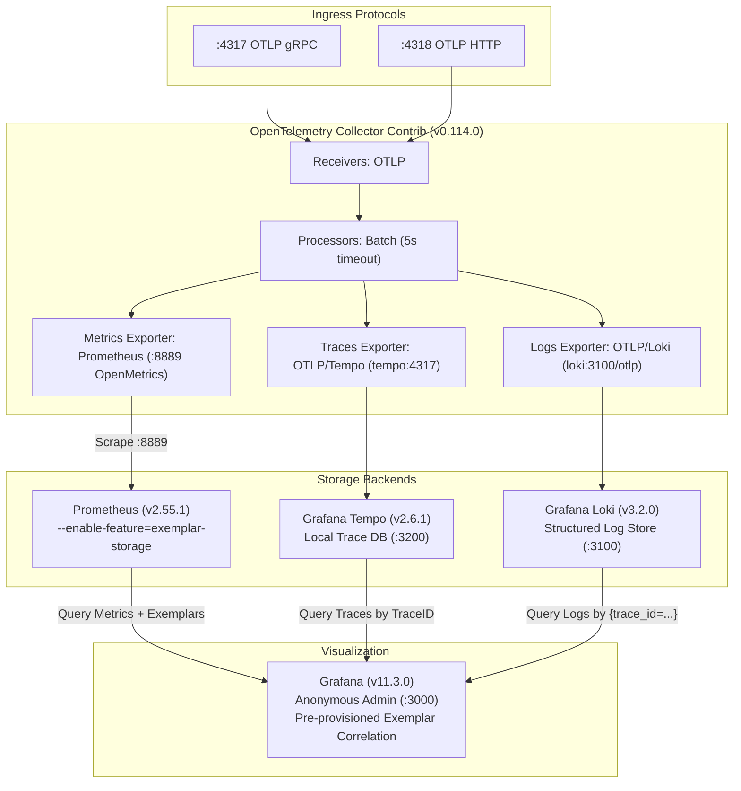

# collector/ - Local OpenTelemetry Telemetry Routing & Storage Stack

This directory contains the production-grade configurations and declarative provisioning for the local observability stack running via Docker Compose.

---

## Architecture & Data Flow



---

## Directory Layout

```
collector/
|-- otel-collector-config.yaml    # Receivers (4317/4318), processors, exporters (Prometheus, Tempo, Loki)
|-- prometheus.yaml               # Scrape config (1s interval) targeting collector:8889
|-- tempo.yaml                    # Single-binary Tempo trace store with OTLP receiver
|-- loki.yaml                     # Single-process Loki log store with OTLP HTTP endpoint
`-- grafana/
    |-- provisioning/
    |   |-- datasources/
    |   |   `-- datasources.yaml  # Configures Tempo with tracesToLogsV2 (Loki) & Prometheus with exemplarTraceIdDestinations (Tempo)
    |   `-- dashboards/
    |       `-- dashboards.yaml   # Auto-loads JSON dashboards from /etc/grafana/dashboards
    `-- dashboards/
        `-- exemplars-overview.json # Ready-to-use Grafana dashboard with Exemplar overlays
```

---

## Key Configurations Explained

### 1. Prometheus Exemplar Storage (`prometheus.yaml` & `docker-compose.yaml`)
Prometheus requires explicit activation of exemplar storage:
```yaml
command:
  - "--enable-feature=exemplar-storage"
```
The scraper runs with a 1-second interval against `otel-collector:8889`, extracting histograms with active exemplars encoded in OpenMetrics format.

### 2. Bidirectional Correlation in Grafana (`datasources.yaml`)
Grafana links all three pillars automatically without manual query stitching:
1. **Prometheus -> Tempo**:
   ```yaml
   exemplarTraceIdDestinations:
     - datasourceUid: tempo
       name: trace_id
   ```
2. **Tempo -> Loki**:
   ```yaml
   tracesToLogsV2:
     datasourceUid: loki
     tags: ['service.name']
     filterByTrace: true
     customQuery: true
     query: '{service_name="$${__span.service.name}"} |= "$${__span.traceId}"'
   ```

---

## Usage

Start the stack from the repository root:
```bash
docker compose up -d
```
All datasources and dashboards are automatically loaded in Grafana at [http://localhost:3000](http://localhost:3000).
