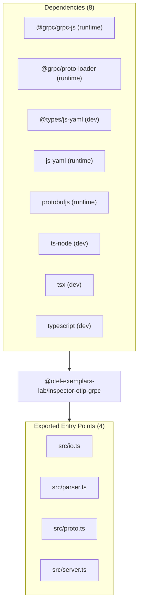

# @otel-exemplars-lab/inspector-otlp-grpc — Package Overview

## Objective

`@otel-exemplars-lab/inspector-otlp-grpc` is a package in project `@otel-exemplars-lab/inspector-otlp-grpc`. Custom OpenTelemetry OTLP/gRPC MetricsService receiver in TypeScript for inspecting Prometheus Exemplars, trace_id/span_id correlations, and raw Protobuf payloads.

## Architecture & Surface Metrics

| Metric | Value | Provenance |
| :--- | :---: | :--- |
| **Exported Surface** | `4` files | Verified package entry points |
| **Public Symbols** | `15` declarations | Syntax-first AST extraction |
| **Dependencies** | `8` packages | `package.json` manifest |
| **Evidence Records** | `15` JSDoc blocks | AST comment provenance |

## Exports

- `src/io.ts`
- `src/parser.ts`
- `src/proto.ts`
- `src/server.ts`

## Dependencies

- `@grpc/grpc-js` (`^1.8.14`) — runtime
- `@grpc/proto-loader` (`^0.7.6`) — runtime
- `@types/js-yaml` (`^4.0.5`) — dev
- `js-yaml` (`^4.1.0`) — runtime
- `protobufjs` (`^7.2.5`) — runtime
- `ts-node` (`^10.9.1`) — dev
- `tsx` (`^3.12.7`) — dev
- `typescript` (`^5.1.6`) — dev

## Sources Used

- Package manifest `package.json` at snapshot `snapshot:v1:project:v1:b34c28a49d6b2d4a:git:716ad9d553503d89b180c91c884ffc5beca80f06`.
- `DEFAULT_METRICS_PROTO_REL_PATH` (constant) — documentation evidence.
- `ExemplarSample` (interface) — documentation evidence.
- `ExemplarSummary` (interface) — documentation evidence.
- `InspectorServerOptions` (interface) — documentation evidence.
- `MetricsServiceDefinition` (interface) — documentation evidence.
- `OutputDirectories` (interface) — documentation evidence.
- `dataType` (type-alias) — documentation evidence.
- `ensureDirs` (function) — documentation evidence.
- `extractExemplarSummaries` (function) — documentation evidence.
- `fileType` (type-alias) — documentation evidence.
- `loadMetricsService` (function) — documentation evidence.
- `requestToJson` (function) — documentation evidence.
- `requestToYaml` (function) — documentation evidence.
- `startServer` (function) — documentation evidence.
- `writeOutputs` (function) — documentation evidence.
