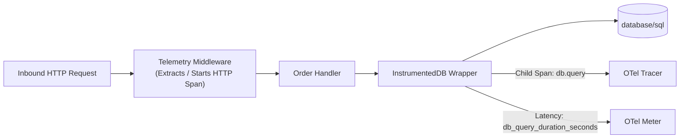

# producer-go-sql - Instrumented Go HTTP Service & sql.DB Trace Spans

[](https://go.dev/)
[](https://opentelemetry.io/)

A reference Go service demonstrating end-to-end telemetry propagation across HTTP handlers and relational database interactions (`database/sql`):
- **Custom `InstrumentedDB` Wrapper**: Transparent wrapper intercepting `QueryContext`, `ExecContext`, and `QueryRowContext`.
- **Database Child Spans**: Creating child spans (`db.query`, `db.exec`) attached to the parent HTTP distributed trace.
- **Query Latency Histograms**: Emitting `db_query_duration_seconds` metrics correlated with active trace IDs.

---

## Architecture & Code Pattern



### The `InstrumentedDB` Wrapper (`src/database/instrumented_db.go`)
Instead of invasive code changes in SQL query logic, the `InstrumentedDB` embeds `*sql.DB` and decorates standard execution calls:
1. Records `db.system`, `db.statement`, and query duration.
2. Captures errors directly onto the active span (`span.RecordError(err)`).
3. Records query duration in the metric histogram, attaching trace metadata as an exemplar.

---

## Quickstart

```bash
# 1. Build and run tests
go test ./...
go build -v -o producer-go-sql .

# 2. Run service (targets localhost:4317 by default)
./producer-go-sql

# 3. Trigger database query endpoint
curl http://localhost:8081/orders
```
